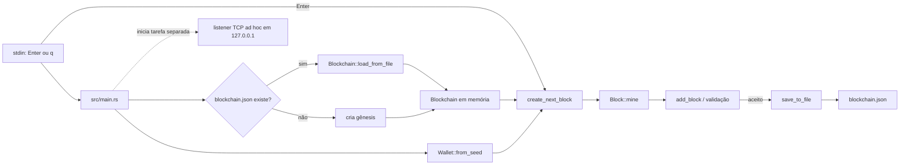

# Arquitetura atual

Este documento descreve o que o executável realmente faz hoje. Ele separa os módulos existentes dos caminhos que ainda são protótipos para evitar sugerir uma integração que o código não tem.

## Visão do executável

O listener do `main` apenas lê bytes, imprime o conteúdo e responde com uma confirmação textual. Ele não decodifica `network::messages::Message`, não altera a blockchain e não compartilha o estado com os peers.

## Módulos

### `models`

- `block.rs` define `Block` e `BlockHeader`, calcula cabeçalhos e executa a busca de nonce.
- `transaction.rs` define inputs e outputs, assinatura/verificação Ed25519 e reconhecimento de coinbase.
- `blockchain.rs` mantém a cadeia, a mempool e o mapa UTXO; também seleciona transações e cria blocos candidatos.
- `chain_validation.rs` contém verificações de transação, bloco e cadeia completa. As regras ainda estão incompletas e têm uma issue dedicada.
- `chain_persistence.rs` serializa um snapshot JSON com cadeia, UTXOs e mempool.

### `crypto`

- `hashing.rs` fornece o tipo `Hash`, hashing duplo SHA-256 sobre serialização bincode, raiz/prova de Merkle e HMAC.
- `wallet.rs` gera chaves aleatórias para uso programático e oferece uma derivação determinística usada pelo executável de demonstração.

### `db`

`sql_connection.rs` define tabelas e operações para blocos, transações, UTXOs e mempool. O `main` não cria nem usa `Database`; portanto, o backend efetivo do executável é o snapshot JSON.

### `network`

`messages.rs` declara variantes para descoberta, versão, transações, blocos e solicitação de cadeia. `server.rs` aceita conexões TCP e imprime a primeira leitura. Os tipos de mensagem e o listener ainda não formam um protocolo funcional.

## Modelo de dados e fluxo

1. Uma transação referencia saídas anteriores por `(tx_hash, output_index)`.
2. O estado UTXO associa essa chave a um `Output` com valor e chave pública destinatária.
3. O envio para a mempool valida a transação contra o estado atual; a criação de bloco seleciona as transações válidas e acrescenta uma coinbase.
4. A mineração incrementa o nonce até o hash do cabeçalho satisfazer a dificuldade em bits.
5. Ao aceitar um bloco, o nó remove UTXOs gastos, insere novas saídas e adiciona o bloco à cadeia.
6. O executável grava o snapshot JSON depois de cada bloco aceito.

Esses passos representam o desenho pretendido pelo código, não uma especificação de consenso completa. Há casos como inputs duplicados, verificação de assinatura por input e somas fora do intervalo que ainda precisam de regras explícitas.

## Limites e confiança

- **Chaves:** a frase usada pelo minerador é fixa no código. Nunca reutilize essa chave para ativos reais.
- **Validação:** a rotina que adiciona blocos não cobre todas as regras monetárias e de estado. A verificação da cadeia completa também não reconstrói o estado UTXO nem valida cada transação.
- **Persistência:** o JSON carregado contém tanto os blocos quanto um UTXO set persistido; hoje o último é aceito sem reconstrução integral. O parser usa operações que podem entrar em pânico.
- **Rede:** TCP é um fluxo de bytes, mas o listener atual faz uma leitura limitada e não define framing, tamanho máximo ou tratamento de mensagens concatenadas/fragmentadas.
- **SQLite:** há código experimental, mas não há escolha de backend configurável nem sincronização entre SQLite e o snapshot JSON.

## Próximas etapas

As issues [#2](https://github.com/Bappoz/utxo-blockchain/issues/2) a [#5](https://github.com/Bappoz/utxo-blockchain/issues/5) detalham as próximas etapas: invariantes de consenso, recuperação de estado, protocolo P2P e testes/CI. A evolução deve manter esses limites documentados até cada integração ter sido concluída.
