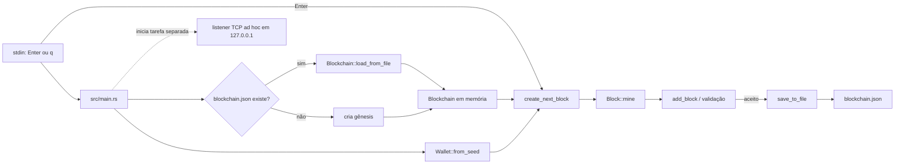

# Arquitetura atual

Este documento descreve o que o executável realmente faz hoje. Ele separa os módulos existentes dos caminhos que ainda são protótipos para evitar sugerir uma integração que o código não tem.

## Visão do executável

O listener do `main` apenas lê bytes, imprime o conteúdo e responde com uma confirmação textual. Ele não decodifica `network::messages::Message`, não altera a blockchain e não compartilha o estado com os peers.

## Módulos

### `models`

- `block.rs` define `Block` e `BlockHeader`, calcula cabeçalhos e executa a busca de nonce.
- `transaction.rs` define inputs e outputs, assinatura/verificação Ed25519 e reconhecimento de coinbase.
- `blockchain.rs` mantém a cadeia, a mempool e o mapa UTXO; também seleciona transações e cria blocos candidatos.
- `chain_validation.rs` verifica assinatura por input, valores, ordem de transações, coinbase, recompensa, Proof of Work e replay completo da cadeia. A política implementada está detalhada em [consensus.md](consensus.md).
- `chain_persistence.rs` grava snapshots JSON por arquivo temporário e rename; ao carregar, valida/reexecuta a cadeia, reconstrói UTXOs e revalida a mempool.

### `crypto`

- `hashing.rs` fornece o tipo `Hash`, hashing duplo SHA-256 sobre serialização bincode, raiz/prova de Merkle e HMAC.
- `wallet.rs` gera chaves aleatórias para uso programático e oferece uma derivação determinística usada pelo executável de demonstração.

### `db`

`sql_connection.rs` define tabelas e operações para blocos, transações, UTXOs e mempool. Gravações de bloco/transações e drenagem da mempool usam transações SQL; conversões numéricas são checadas. O `main` não cria nem usa `Database`; portanto, o backend efetivo do executável continua sendo o snapshot JSON.

### `network`

`messages.rs` declara variantes para descoberta, versão, transações, blocos e solicitação de cadeia. `server.rs` aceita conexões TCP e imprime a primeira leitura. Os tipos de mensagem e o listener ainda não formam um protocolo funcional.

## Modelo de dados e fluxo

1. Uma transação referencia saídas anteriores por `(tx_hash, output_index)`.
2. O estado UTXO associa essa chave a um `Output` com valor e chave pública destinatária.
3. O envio para a mempool valida a assinatura de cada input com a chave do UTXO correspondente e reserva inputs já usados por outra transação pendente.
4. A criação de bloco seleciona transações em sequência sobre um estado temporário; uma transação posterior pode usar uma saída criada antes no mesmo bloco, mas não pode reutilizar um input já gasto.
5. A coinbase leva a altura como tag para que recompensas iguais em blocos diferentes tenham identificadores distintos; o minerador recebe no máximo a recompensa base mais as taxas.
6. A mineração incrementa o nonce até o hash do cabeçalho satisfazer a dificuldade em bits.
7. Ao aceitar um bloco, o nó remove UTXOs gastos, insere novas saídas e adiciona o bloco à cadeia.
8. O executável grava o snapshot JSON depois de cada bloco aceito.

Esses passos representam as regras implementadas, não uma especificação de consenso completa. Veja [consensus.md](consensus.md) para as regras ausentes e os limites atuais.

## Limites e confiança

- **Chaves:** a frase usada pelo minerador é fixa no código. Nunca reutilize essa chave para ativos reais.
- **Validação:** blocos são reexecutados sobre uma cópia temporária do estado e a cadeia completa é reconstruída desde o gênesis. Ainda faltam regras temporais, ajuste de dificuldade e outros limites necessários a uma rede de produção.
- **Persistência:** o UTXO set salvo é tratado como cache e reconstruído pelo replay dos blocos. JSON inválido, versão futura ou cadeia inválida retorna erro legível; snapshots antigos com coinbases sem tag de altura podem precisar ser recriados.
- **Rede:** TCP é um fluxo de bytes, mas o listener atual faz uma leitura limitada e não define framing, tamanho máximo ou tratamento de mensagens concatenadas/fragmentadas.
- **SQLite:** há código experimental, mas não há escolha de backend configurável nem sincronização entre SQLite e o snapshot JSON.

## Próximas etapas

A issue [#2](https://github.com/Bappoz/utxo-blockchain/issues/2) registra o trabalho de invariantes descrito neste documento e em [consensus.md](consensus.md). A recuperação de estado está sendo tratada na issue [#3](https://github.com/Bappoz/utxo-blockchain/issues/3); as próximas etapas são protocolo P2P ([#4](https://github.com/Bappoz/utxo-blockchain/issues/4)) e testes/CI ([#5](https://github.com/Bappoz/utxo-blockchain/issues/5)).
